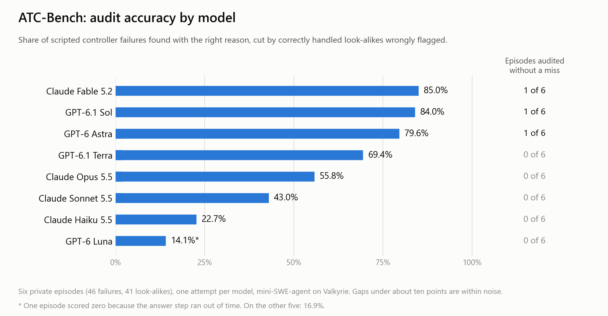
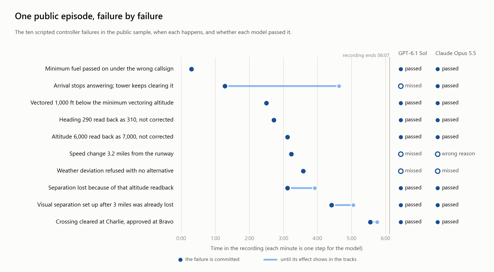

# ATC-Bench

Can a model audit air traffic control from a transcript, one minute at a time?

## Overview

ATC-Bench asks whether an AI model can audit air traffic control. Each task is six or seven minutes of scripted radio and radar at a made-up airport. The model gets it one minute at a time and can only carry a small notes file forward. Btw, that's how controllers work too, with their flight strips. At the end the model audits the controllers against the FAA handbook. The best models found about 85% of the planted failures. That said, the top three each got only one recording in six completely right.



## How it works

- **The task.** One recording of six or seven busy minutes at a made-up US airport: 16 or 17 aircraft, the tower, ground and approach frequencies, the controllers' phone line, and radar positions every five seconds. The radio is a written transcript with no speaker labels.
- **One minute at a time.** The model gets the recording a minute at a time and starts each minute with no memory of the last one. All it carries forward is a notes file of 6,000 characters, about two pages for a sixteen-page recording.
- **Why a notes file.** Controllers work from written notes. FAA Order JO 7110.65, paragraph 2-3-1, has them post current traffic and clearances on flight progress strips and "maintain only necessary current data". The size of the file is my own choice.
- **The audit.** After the last minute the recording is taken away. The model sees the questions for the first time and answers from its notes. The main question asks it to list every instance where a controller did not meet a requirement of the order. About twelve more questions check the picture directly, such as an aircraft's last cleared altitude.
- **What's scripted.** Each recording has six to ten real controller failures and four to ten look-alikes, which are the same kind of event handled correctly. In one public sample, visual separation is set up while two aircraft are still more than three miles apart, which is fine. In the other it is set up when they are already 2.7 miles apart, so separation had already been lost.

The model is the auditor and never acts as a controller. The six test recordings stay private, and this page doesn't describe what's in them.

## Scoring

A finding counts for a failure when it names the right controller position and one of the aircraft involved. A judge model, Claude Opus 5.5, then grades the written reason against two to four criteria for that failure, and the essential ones must be met. A look-alike counts against the model only when a finding is about that event.

**Audit accuracy** is the share of real failures found with every essential criterion met, multiplied by the share of look-alikes left alone, averaged over the recordings.

## Results

Six private test episodes with 46 real failures and 41 look-alikes. Each model ran each episode once.

| Model | Audit accuracy | Failures passed (of 46) | Look-alikes left alone (of 41) | Episodes audited without a miss (of 6) |
|---|---|---|---|---|
| Claude Fable 5.2 | 85.0% | 39 | 41 | 1 |
| GPT-6.1 Sol | 84.0% | 39 | 41 | 1 |
| GPT-6 Astra | 79.6% | 38 | 40 | 1 |
| GPT-6.1 Terra | 69.4% | 32 | 41 | 0 |
| Claude Opus 5.5 | 55.8% | 26 | 39 | 0 |
| Claude Sonnet 5.5 | 43.0% | 20 | 40 | 0 |
| Claude Haiku 5.5 | 22.7% | 12 | 36 | 0 |
| GPT-6 Luna | 14.1%* | 6 | 36 | 0 |

\* One of Luna's episodes scored zero, because its answer step ran out of time. On the other five it scores 16.9%.

- Claude Fable 5.2 and GPT-6.1 Sol are level at the top, with GPT-6 Astra close behind. With one run per model, a gap of less than about ten points is noise.
- The best model finds 85% of the individual failures, and the top three each get one episode in six completely right.
- Models rarely flag a look-alike. The low scores come from failures the models missed.
- GPT-6.1 Sol matches Claude Fable 5.2 for about one twentieth of the cost: $2.58 against about $54 for the six episodes.
- With a notes file half the size, Sol, Terra and Haiku lose 12 to 14 points.

A breakdown by kind of failure isn't published, because it would describe what the test episodes contain.

### One public episode

The worked example uses a public episode, `atc-mvp-l05-s9103`, in `examples/`. It has ten real failures and five look-alikes. GPT-6.1 Sol scored 70.0% on it and Claude Opus 5.5 scored 80.0%.



At 03:30 a pilot asks for a turn to get around weather and is refused:

```
03:30 [119.1] Approach, Envoy two six three seven, like to come right 30 degrees for weather
03:35 [119.1] envoy two six three seven, unable, traffic off your right
```

Nobody says anything else to that aircraft about the weather. The handbook says a refusal has to come with another way out. Sol's notes have the exchange down accurately:

```
03:30 request right30deg weather;:35 UNABLE traffic right;:39 roger. No deviation/descent authorized.
```

Neither model reported it. Sol had the facts in its notes and didn't apply the rule.

## How it was run

- **Harness.** mini-SWE-agent (v2.4.6) on Valkyrie, in Modal sandboxes. It works with both Anthropic and OpenAI models, so every model gets the same harness. It gives the model only a shell, so the score comes from the model itself.
- **No public internet.** The sandbox can reach the two model providers' API hosts and nothing else.
- **Steps.** One step for each minute, then an answer step. Between steps the notes are cut to the limit and everything else in the working directory is deleted. Each minute gets 300 seconds and the answer step gets 420.
- **Judge.** Claude Opus 5.5 grades each written reason. It never sees which model wrote the answer.
- **Data.** Six private test episodes, and two public samples with their answer keys in `examples/atc-sample-tasks.zip`.

## Limits

- Each model ran once, on 46 failures.
- No controller has reviewed the answer keys.
- The traffic is simulated, the airport is made up, and the notes limit is a number I chose.
- The judge is also one of the models tested. Claude Opus 5.5 graded every model including itself, and it ranked itself fifth.
- Two scoring rules cost some models a few points. They are described in the [full write-up](DETAILS.md#what-were-less-sure-about).

## How to run it

Install the Valkyrie CLI and sign in:

```bash
uv tool install valkyrie-cli
valkyrie login
```

Unzip the public samples and upload them as a dataset of your own:

```bash
unzip examples/atc-sample-tasks.zip -d examples/tasks
valkyrie dataset push my-benchmark/atc-sample ./examples/tasks --tag v1
```

Then run a model on it. The second secret is the judge's key.

```bash
valkyrie run start --agent mini_swe_agent \
  --dataset my-benchmark/atc-sample@v1 \
  --model openai/gpt-6.1-sol --provider modal \
  -s OPENAI_API_KEY openai-api-key \
  -s ANTHROPIC_API_KEY anthropic-api-key \
  -k cost_tracking ignore_errors
```

## Run IDs

Valkyrie run IDs for the main results. The runs with half the notes and the runs on the public samples are listed in the [full write-up](DETAILS.md#run-ids).

| Model | Run ID |
|---|---|
| Claude Fable 5.2 | `451a78f4-af02-4b3d-87e5-579085d39d95` (five episodes) and `7f507671-d72d-4741-8249-8a2256d80f63` (one) |
| GPT-6.1 Sol | `88f175f3-5398-465e-93f1-5386ef9c8ca5` |
| GPT-6 Astra | `0c4cb6f1-ffbf-4a8d-818b-be232c265d85` |
| GPT-6.1 Terra | `b219611f-25e9-4eba-9820-d269f1d7541a` |
| Claude Opus 5.5 | `5fcb64b3-0a1e-4ffc-81c7-4301adde5be2` |
| Claude Sonnet 5.5 | `c36940df-4876-475c-a059-09e1bb991f3e` |
| Claude Haiku 5.5 | `d75bf557-0236-48ee-831e-4b6692d13992` |
| GPT-6 Luna | `28458298-2363-4cc8-91b2-da7330c7a9ba` |

## What's in this repo

- `README.md`: this page.
- `DETAILS.md`: the full write-up, with every table and the method in detail.
- `examples/`: two public sample tasks in Harbor format, with their answer keys.
- `scoring/`: the scorer (`score.py`) and the judge (`judge.py`).
- `figures/` and `results/`: the charts and the numbers behind them.

## Citation

```bibtex
@misc{atcbench2026,
  title        = {ATC-Bench: Auditing Air Traffic Control From a Recording, One Minute at a Time},
  author       = {vrtnis},
  year         = {2026},
  month        = nov,
  howpublished = {Vals AI hackathon, Build Your Own Eval track},
  url          = {https://github.com/vrtnis/atc-bench},
}
```
