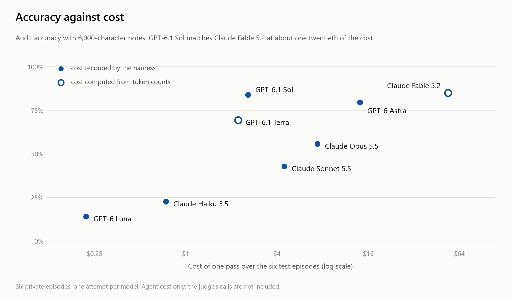

# ATC-Bench

Can a model listen to air traffic control and catch what the controllers got wrong?

## Overview

ATC-Bench asks whether an AI model can listen to air traffic control and catch what the controllers got wrong. Having flown general aviation aircraft myself, I was curious whether AI models would catch the kinds of situations I've come across on the radio. Each task is six or seven minutes of scripted radio and radar at a made-up airport. The model gets it one minute at a time and can only carry a small notes file forward. Btw, that's how controllers work too, with their flight strips. At the end the model audits the controllers against the FAA handbook. The best models caught about 85% of the planted failures. That said, the top three each got only one recording in six completely right.


## What's in this repo

- `README.md`: how the benchmark works, the results, and how to run it.
- `examples/`: two public sample tasks in Harbor format, with their answer keys.
- `scoring/`: the scorer (`score.py`) and the judge (`judge.py`).
- `figures/` and `results/`: the charts on this page and the numbers behind them.

The six test tasks, their answer keys and the script that generates them are kept private so models can't train on them. This page also leaves out what the test episodes contain. All of it is available to the Vals team privately.

## How it works

Controllers talk about "keeping the picture". It means following a lot of aircraft at once, remembering what each one was told, watching what each one is doing, and noticing when those two things stop matching. ATC-Bench checks whether a model can do that.

We picked air traffic control for two reasons. An agent that watches anything for hours has the same job as a controller. It has to keep track of a lot of things over a long stretch and decide what matters as it goes. The rules are also public. FAA Order JO 7110.65, the controllers' handbook, says what a controller must do, so every answer can be checked against the text.

Each task is a recording of a busy six or seven minutes at a made-up US airport. There are 16 or 17 aircraft, three radio frequencies (tower, ground and approach), the phone line between the controllers, and radar positions every five seconds. A recording has between 124 and 143 radio calls and about 1,270 radar rows.

The radio is written the way it sounds. Nobody is labelled as the speaker. Callsigns get shortened and said several different ways. Phrases are clipped, and some calls get stepped on and have to be repeated.

The model hears the recording one minute at a time, and it starts every minute with no memory of the last one. All it can carry forward is a notes file of 6,000 characters. A whole recording is about 49,000 characters, so think of it as two pages of notes for a sixteen-page recording. The model has to decide, as it listens, what's worth writing down.

We use a notes file because controllers work from written notes. Paragraph 2-3-1 of the order tells them to use flight progress strips to post current data on air traffic and clearances, and to "maintain only necessary current data". The notes file is the model's set of strips. The size, 6,000 characters, is our own choice.

After the last minute the recording is taken away, and the model sees the questions for the first time. It answers from its notes.

The main question is an audit. We ask the model to list every place where a controller broke a rule in FAA Order JO 7110.65, the controllers' handbook, and to give the position, the aircraft, the paragraph and a short reason. About twelve more questions check the picture directly. For example, we ask for the last altitude an aircraft was told to climb to, which pairs of aircraft are too close together, and which arrival will have to go around.

This is a review after the fact, like a quality reviewer listening back to a tape. Catching a mistake live, while the controller is still talking, is outside what we test.

### Scripted failures and look-alikes

Every recording is scripted. Each one has six to ten real controller failures in it. It also has four to ten look-alikes, which are the same kind of event handled correctly, where one detail changes the answer.

Here's an example from the two public samples. In `atc-mvp-l05-s9003` a pilot has the other aircraft in sight, and visual separation is put in place while the two are still more than three miles apart. They can then get closer than three miles and that's fine. In `atc-mvp-l05-s9103` the controller sets up visual separation the same way, but only when the two aircraft are already about 2.7 miles apart, so separation had already been lost.

A lot of the failures only show up when you put the radio together with the radar. The answer keys of the two public samples list every scripted event in them, with the criteria used to grade it. This page doesn't describe what's in the six test episodes.

## How we score it

Each scripted event is either a real failure, which the model should find, or a look-alike, which it should leave alone. A finding counts for a failure when it names the right controller position and one of the aircraft involved. If the model reports something we didn't script, that neither helps nor hurts its score. We don't score the paragraph number, because the numbering changes between editions of the handbook.

We also grade the reason the model writes. A judge model reads it against a short list of criteria for that failure. Each criterion has a weight from 1 to 3. The weight-3 ones are essential. They cover the failure itself, or the step of reasoning that shows the model worked it out, such as tracing a loss of separation back to the readback error that caused it. A failure has two to four criteria (2.7 on average, 125 across the test set), and one or two of them are essential (57 across the test set).

A look-alike only counts against the model when a finding is about that event.

Our main number is **Audit accuracy**. It's the share of real failures the model found with every essential criterion met, multiplied by the share of look-alikes it left alone, averaged over the episodes. A model that reports everything it sees loses credit on the look-alikes. A model that reports very little loses credit on the failures.

We report three more numbers beside it:

- **Partial credit**: the same thing, with each failure earning the weighted share of its criteria.
- **Picture**: the exact-match score on the other questions.
- **Strict**: how many episodes had every check on every question pass.

## Results

Everything here is from the six private test episodes. Together they have 46 real failures and 41 look-alikes. Each model ran each episode once.

| Model | Audit accuracy | Failures passed (of 46) | Look-alikes left alone (of 41) | Episodes audited without a miss (of 6) |
|---|---|---|---|---|
| Claude Fable 5.2 | 85.0% | 39 | 41 | 1 |
| GPT-6.1 Sol | 84.0% | 39 | 41 | 1 |
| GPT-6 Astra | 79.6% | 38 | 40 | 1 |
| GPT-6.1 Terra | 69.4% | 32 | 41 | 0 |
| Claude Opus 5.5 | 55.8% | 26 | 39 | 0 |
| Claude Sonnet 5.5 | 43.0% | 20 | 40 | 0 |
| Claude Haiku 5.5 | 22.7% | 12 | 36 | 0 |
| GPT-6 Luna | 14.1%* | 6 | 36 | 0 |

\* One of Luna's episodes scored zero on everything, because its answer step ran out of time before it wrote any answers. On the other five episodes Luna scores 16.9%.

Claude Fable 5.2 and GPT-6.1 Sol are level at the top, with GPT-6 Astra close behind. The best model catches 85% of the individual failures, and the top three each get one episode in six completely right. Astra is the only model that had an episode where every check on every question passed.

With one run per model and 46 failures, a gap of less than about ten points is noise.

Models rarely blame a controller who did nothing wrong. Setting aside the Luna episode that went unanswered, the worst result on look-alikes is 36 of 41 left alone. The low scores come from failures the models missed.

We don't publish a breakdown by kind of failure. It would describe what the test episodes contain, and they are meant to stay unseen. The walk-through below uses a public episode instead.

### A walk through one public episode

The test episodes are private, so this example uses a public one, `atc-mvp-l05-s9103`, which you can find in `examples/`. We picked it for what's in it, before any model had run on it. It has ten real failures and five look-alikes.

GPT-6.1 Sol scored 70.0% on it and Claude Opus 5.5 scored 80.0%. Both left all five look-alikes alone. Each model ran once, and one of Opus's note-taking steps ended with a formatting error.


The chart puts the ten failures along the recording and shows what each model did with each one.

**The refused deviation.** At 03:30 a pilot asks Metro Approach for a turn to get around weather, and gets refused.

```
03:30 [119.1] Approach, Envoy two six three seven, like to come right 30 degrees for weather
03:35 [119.1] envoy two six three seven, unable, traffic off your right
```

Nobody says anything else to that aircraft about the weather. Sol's notes have the exchange down accurately:

```
03:30 request right30deg weather;:35 UNABLE traffic right;:39 roger. No deviation/descent authorized.
```

Neither model reported it. Sol had the exchange in its notes when it wrote its audit, and it didn't apply the rule that a refusal has to come with another way out.

**The arrival that stops answering.** United 1517 reads back a descent at 00:36 and never transmits again. The tower keeps talking to it.

```
00:31 [118.3] united seventeen, descend and maintain three thousand
00:36 [118.3] Down to three thousand, United 1517
01:17 [118.3] United one five one seven, cleared visual approach runway two seven right
02:52 [118.3] united fifteen seventeen, runway two seven right, cleared to land
03:14 [118.3] United 1517, reduce speed to 130
```

It lands at 04:38 without acknowledging its approach clearance, its landing clearance or the speed instruction. Sol's notes show it saw part of this:

```
UAL1517:visual27R01:17,land27R02:52.03:14 reduce130;blocked/no identifiable readback;track150 then135 at210s. Touchdown~278s.
```

Sol wrote "no identifiable readback" and then reported nothing about this aircraft. Opus did report it. It wrote that the tower "got no readback or acknowledgment" and that the aircraft landed "without the tower ever confirming that the pilot had received the clearance".

**The speed instruction behind it.** The last of those calls is a failure too. At 03:14 the aircraft is 3.2 miles from the runway, inside the final approach fix, and the handbook allows no speed adjustment there. Opus quoted the instruction as one of the unanswered calls and didn't say it was prohibited. Sol wrote it down and said nothing.

We also made a second public sample, `atc-mvp-l05-s9003`. Sol scored 88.9% on it and Opus scored 100%.

### Partial credit and the picture questions

| Model | Audit accuracy | Partial credit | Picture |
|---|---|---|---|
| Claude Fable 5.2 | 85.0% | 83.5% | 97.7% |
| GPT-6.1 Sol | 84.0% | 83.1% | 97.4% |
| GPT-6 Astra | 79.6% | 79.0% | 95.8% |
| GPT-6.1 Terra | 69.4% | 67.2% | 91.3% |
| Claude Opus 5.5 | 55.8% | 55.1% | 93.1% |
| Claude Sonnet 5.5 | 43.0% | 41.8% | 91.2% |
| Claude Haiku 5.5 | 22.7% | 21.7% | 84.3% |
| GPT-6 Luna | 14.1%* | 13.8%* | 59.6%* |

Partial credit is within three points of Audit accuracy for every model. A failure is usually found together with its reasoning or missed entirely.

The picture questions are easier. Opus and Sonnet get more than 90% of them right and still pass fewer than six failures in ten. They keep an accurate picture of where the aircraft are and what they were told, and they miss what the controllers did wrong with it.

### Cost and speed



The chart sets each model's Audit accuracy against what it cost to run the six test episodes once. GPT-6.1 Sol, at the top left, matches Claude Fable 5.2 for about one twentieth of the cost.

| Model | Working time per minute of recording | Cost of six episodes |
|---|---|---|
| Claude Fable 5.2 | 156 s | about $54 (computed) |
| GPT-6.1 Sol | 40 s | $2.58 |
| GPT-6 Astra | 40 s | $14.11 |
| GPT-6.1 Terra | 63 s | about $2.20 (computed) |
| Claude Opus 5.5 | 41 s | $7.41 |
| Claude Sonnet 5.5 | 38 s | $4.47 |
| Claude Haiku 5.5 | 104 s | $0.74 |
| GPT-6 Luna | 50 s | $0.22 |

The harness doesn't record a cost for Fable or Terra, so we worked theirs out from the token counts in the logs. The same sum for Opus comes within 5% of its recorded cost. None of these figures include the judge's calls.

Working time is the median time a model spent on one minute of recording. The limit was 300 seconds. The model gets each minute after it has happened, so these numbers tell you how long a review takes. They say nothing about how fast a model could flag a problem live.

### Steps that ran out of time

Each minute of recording gets 300 seconds and the final questions get 420. A step that runs over is stopped.

| Model | Steps cut short | What was lost |
|---|---|---|
| Claude Fable 5.2 | 2 of 48 | Two note-taking steps in one episode. The notes had already been saved. |
| GPT-6 Luna | 2 of 48 | One note-taking step and one answer step. No answers were written, so that episode scored zero. |
| All others | 0 | |

### With half the notes

We also ran every model with a notes file half the size, 3,000 characters, on the same six episodes.

| Model | Audit accuracy, 6,000 | Audit accuracy, 3,000 |
|---|---|---|
| Claude Fable 5.2 | 85.0% | 72.0%** |
| GPT-6.1 Sol | 84.0% | 71.3% |
| GPT-6 Astra | 79.6% | 83.5% |
| GPT-6.1 Terra | 69.4% | 55.8% |
| Claude Opus 5.5 | 55.8% | 54.0% |
| Claude Sonnet 5.5 | 43.0% | 46.1% |
| Claude Haiku 5.5 | 22.7% | 10.6% |
| GPT-6 Luna | 14.1%* | 21.6% |

\*\* One of Fable's episodes at this size scored zero, because its answer step ran out of time. On the other five it scored 86.4%, so the smaller notes file left its score about where it was.

Halving the notes cost Sol, Terra and Haiku 12 to 14 points each. Astra, Opus and Sonnet moved by less than four points either way, which is noise.

Both sizes are numbers we chose. Seven minutes of traffic fits easily in any of these models' context windows. A full shift at this pace would be around 900,000 tokens, and that's the situation the limit stands in for.

## How we ran it

### The harness, and why we picked it

Every model ran on mini-SWE-agent (v2.4.6) on Valkyrie, in Modal sandboxes. We picked it for two reasons. It works with both Anthropic and OpenAI models, so every model gets the same harness. It also gives the model only a shell, so the score comes from the model itself, with no help from a scaffold's own memory or planning features.

The agents have no public internet. The sandbox can reach the two model providers' API hosts and nothing else.

The harness doesn't set a reasoning level, so every model ran at its provider's default. All eight reasoned before acting. The share of output tokens that went on reasoning was 79% for Haiku 5.5, 58% for Luna, 50% for Fable 5.2, 46% for Sonnet 5.5, 33% for Opus 5.5, 20% for Terra, 12% for Sol and 9% for Astra. We didn't compare reasoning levels within a model.

Fable 5.2 needed one change. The harness's model library capped its replies at about 4,096 output tokens, which cut it off before it could save its notes. We raised the cap with two environment settings (`DEFAULT_ANTHROPIC_CHAT_MAX_TOKENS` and `DEFAULT_MAX_TOKENS`, both 32000). The cap didn't affect any other model.

### What a task looks like

A task has one step for each minute of recording, then an answer step.

- **In each minute**, the model gets that minute's radio in `current/transcript.txt`, that minute's radar in `current/tracks.csv`, a sheet about the airport in `facility.md`, and its own `notes.md`.
- **Between steps**, `notes.md` is cut to the limit and everything else in the working directory is deleted or reset. Any file written outside the working directory is recorded and reported with the score.
- **In the answer step**, the recording is gone. The model reads the questions for the first time and writes `answers.json`.

### Grading

A script scores the exact-match questions. For the audit, the script works out which finding belongs to which scripted event. Then Claude Opus 5.5, pinned as the judge, marks each written reason against the criteria for that event. The judge is told what happened in each case and never sees which model wrote the answer.

If the judge can't run, the audit is scored on whether each failure was found, and a flag in the results says so. The judge ran on every episode reported here.

### The data

- **Test**: six private episodes, on Valkyrie as `atc-bench/mvp@v13`. The same episodes with a 3,000-character notes limit are `atc-bench/mvp-n3000@v13`.
- **Public samples**: two episodes from seeds outside the test set, in `examples/atc-sample-tasks.zip`, with their answer keys. Each has 16 aircraft. `atc-mvp-l05-s9103` has ten real failures and five look-alikes. `atc-mvp-l05-s9003` has nine failures and four look-alikes. We chose each one for what's in it, before any model ran on it.
- **Generator**: private. A script produces every episode and writes its answer key. It throws away any recording where something we didn't script would break one of the rules we test.

### The rules in the public samples

Every scripted failure rests on a paragraph of FAA Order JO 7110.65. We read each one on faa.gov while building the benchmark. These are the paragraphs behind the events in the two public samples.

| Paragraph | What the controller has to do |
|---|---|
| 2-1-8 | Tell the next facility when an aircraft has reported minimum fuel |
| 2-1-28 | Give no instruction that goes against a TCAS resolution advisory |
| 2-4-3 | Make sure clearances are acknowledged and readbacks are correct |
| 2-6-4 | When a weather deviation can't be approved, give the pilot another way out |
| 3-1-3 | Coordinate a runway crossing with the tower, at the point where it happens |
| 5-5-4 | Keep radar separation, including the larger spacing behind a heavy |
| 5-6-1 | Keep vectored aircraft at or above the minimum vectoring altitude |
| 5-7-1 | Give no speed adjustment inside the final approach fix |
| 7-2-1 | Use visual separation only while other separation still exists |
| 10-4-4 | Try every reasonable way to get back in touch with an aircraft that has gone quiet |

## What we're less sure about

Each model ran once, on 46 failures, so a gap of less than about ten points doesn't tell you much.

No controller has reviewed the answer keys. We checked every rule against the handbook text, but some calls are judgement calls.

We debugged the answer key against one model. Over four builds we read GPT-6.1 Sol's misses and fixed whatever turned out to be unfair. When we later read Opus's and Sonnet's misses, we found two scoring rules that cost them points.

The first was that, for one kind of failure, finding it earned nothing unless the reason also made a second point. Counting the finding on its own would raise Haiku by 4.0 points, Opus by 3.9, Sonnet by 2.1 and Luna by 1.9. It would leave Fable, Sol, Astra and Terra where they are.

The second was that a finding naming an extra aircraft beside the right one matched nothing. That cost at most one failure for any model.

The scores on this page are as run, so you can check them against the run IDs below.

There are three smaller things. One scripted situation could be called a failure and we don't score it, so a model that flags it neither gains nor loses. The time limit for each step isn't stated in the task instructions. And the judge is also one of the models being tested. Claude Opus 5.5 graded every model including itself, and it ranked itself fifth.

The traffic is simulated. The airport is made up, the flight paths are simple, and the notes limit is a number we chose.

## How to run it

Install the Valkyrie CLI and sign in:

```bash
uv tool install valkyrie-cli
valkyrie login
```

Unzip the public samples and upload them as a dataset of your own:

```bash
unzip examples/atc-sample-tasks.zip -d examples/tasks
valkyrie dataset push my-benchmark/atc-sample ./examples/tasks --tag v1
```

Then run a model on it. The second secret is the judge's key. The scoring step reads it inside the sandbox.

```bash
valkyrie run start --agent mini_swe_agent \
  --dataset my-benchmark/atc-sample@v1 \
  --model openai/gpt-6.1-sol --provider modal \
  -s OPENAI_API_KEY openai-api-key \
  -s ANTHROPIC_API_KEY anthropic-api-key \
  -k cost_tracking ignore_errors
```

You can also score an answers file on your own machine. This runs the exact-match checks and skips the judge:

```bash
ATC_JUDGE=off python scoring/score.py key.json answers.json out/
```

You'll find `key.json` in each sample task under `steps/answer/tests/`. If you set `ANTHROPIC_API_KEY`, leave `ATC_JUDGE` unset and install the `anthropic` package, the same command runs the judge too.

## Run IDs

All runs used mini-SWE-agent on the datasets named above. These are the Valkyrie run IDs.

| Model | Main runs (6,000-character notes) | With half the notes (3,000) |
|---|---|---|
| Claude Fable 5.2 | `451a78f4-af02-4b3d-87e5-579085d39d95` (five episodes) and `7f507671-d72d-4741-8249-8a2256d80f63` (one) | `e77b60b4-5b6c-4a48-8b64-b1c9caa39298` |
| GPT-6.1 Sol | `88f175f3-5398-465e-93f1-5386ef9c8ca5` | `9e638d80-33c7-4294-943f-98f971665ed4` |
| GPT-6 Astra | `0c4cb6f1-ffbf-4a8d-818b-be232c265d85` | `671e57cb-533e-4d2b-93ab-f2284f395c49` |
| GPT-6.1 Terra | `b219611f-25e9-4eba-9820-d269f1d7541a` | `5bc7c1e4-55c9-47c3-8183-287dff28916e` |
| Claude Opus 5.5 | `5fcb64b3-0a1e-4ffc-81c7-4301adde5be2` | `f95ae903-0250-4b77-8f49-29392a7f9952` |
| Claude Sonnet 5.5 | `c36940df-4876-475c-a059-09e1bb991f3e` | `29b01049-14de-420d-8b22-7838df281aea` |
| Claude Haiku 5.5 | `d75bf557-0236-48ee-831e-4b6692d13992` | `edb4f6ac-b1d7-49b0-a062-ddcff6191637` |
| GPT-6 Luna | `28458298-2363-4cc8-91b2-da7330c7a9ba` | `70b3ddf0-5d24-4045-bd1d-e44a89327a63` |

Runs on the public samples:

| Model | `atc-mvp-l05-s9103` | `atc-mvp-l05-s9003` |
|---|---|---|
| GPT-6.1 Sol | `bbc19d5e-7eaf-4769-9161-f0dbeb2f7f6a` | `8ca65daa-1114-458d-a5b5-0748e1eaa921` |
| Claude Opus 5.5 | `ef3e4224-0880-429a-afee-c2e5bb89a770` | `5c8d9578-8ab9-4671-8e24-95219b206610` |

## Citation

```bibtex
@misc{atcbench2026,
  title        = {ATC-Bench: Auditing Air Traffic Control From a Recording, One Minute at a Time},
  author       = {vrtnis},
  year         = {2026},
  month        = nov,
  howpublished = {Vals AI hackathon, Build Your Own Eval track},
  url          = {https://github.com/vrtnis/atc-bench},
}
```
